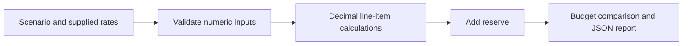

# Cloud Budget Planner

Estimate a small infrastructure scenario and check it against a monthly budget.

The tool reads explicit rates from a JSON file, totals hourly and monthly items, adds a configurable reserve, and reports whether the scenario exceeds its budget. It runs offline and does not connect to a cloud account or create resources.

## Try it

Requires Python 3.11 or newer; no dependencies to install.

```sh
python3 budget.py scenario.json
python3 -m unittest -v
```

The example produces a subtotal of 54.50 and a total of 62.68 with a 15% reserve. Its budget is 100.00, so it passes. All prices are fictional inputs for demonstrating arithmetic, not current provider prices or a quote.

## Scenario format

`scenario.json` is a complete example. Each service needs a unique name, nonnegative quantity and unit price, and a unit of `hour` or `month`. Quantities can represent instances, GB, or another billing unit, as long as the supplied rate uses the same unit.

| Field | Meaning |
| --- | --- |
| currency | Display label; every input rate must use the same currency |
| hours_per_month | Hourly multiplier, from 0 to 744; defaults to 730 |
| monthly_budget | Maximum planned spend |
| headroom_percent | Reserve percentage, from 0 to 100 |
| services | List of independently priced items |



## Calculation

Hourly cost = quantity × unit price × hours per month.

Monthly cost = quantity × unit price.

Projected total = subtotal × (1 + headroom percent / 100).

Calculations use Python Decimal; values are rounded half-up to two decimal places only when reported. The budget comparison uses the unrounded projected total. Consequently, a tiny overage can round to zero remaining budget, and displayed line items may not sum exactly to the rounded subtotal. The tool assumes a currency with two decimal places and performs no currency conversion.

## Automation

Exit codes: 0 for within budget, 1 for over budget, 2 for invalid input. A pipeline can stop on a budget overrun:

```sh
python3 budget.py scenario.json
```

See [VALIDATION.md](VALIDATION.md) for reproducible local validation. Tests also run through GitHub Actions on pushes and pull requests.

## Limits

This is a planning calculator, not a billing integration. Taxes, tiered pricing, commitments, spot interruptions, discounts, data transfer, regional differences, and usage changes are not inferred. Include them as explicit line items where appropriate. Confirm rates with the provider before making a spending decision. Nothing here proves cloud deployment experience or production savings.

## Tests

The suite checks the sample calculation, budget overruns, exact budget boundaries, negative and nonfinite inputs, unsupported units, duplicate names, and decimal rounding.

## Next steps

Add named scenario comparisons and CSV export. A future provider-rate importer should record rate source, region, currency, and retrieval date instead of silently replacing assumptions.

MIT licensed.
